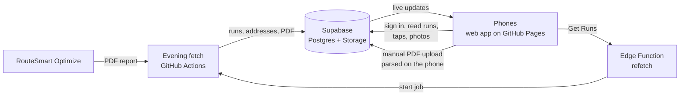

# Architecture

## Pieces
| Piece | Where | What it does |
|---|---|---|
| Web app | `index.html`, `js/`, hosted on GitHub Pages | Everything the family sees. Static files, no build step. Works offline once opened (`sw.js`). |
| Parser | `js/parser.js` | Reads the PDF by text position (pdf.js), builds one tile per address, checks totals, matches Key Report items. The same code runs on the phone and in the fetcher. |
| Evening fetch | `fetcher/fetch-run-sheets.mjs`, `.github/workflows/fetch-run-sheets.yml` | Every 15 minutes from 19:05 to about 21:50 NZ: if tomorrow's runs aren't loaded, signs in to RouteSmart in a hidden browser, requests the report, parses and checks it, saves each run, stores the PDF. Stops once all five runs are in. |
| Get Runs | `supabase/functions/refetch/index.ts` | Checks the caller is a family member, then starts the evening-fetch job for the chosen date (forced, so it replaces what's there). |
| Database | Supabase project `stb-runs` (Sydney), `sql/schema.sql` | Runs, addresses, taps, custom orders, door codes, photos. Row-level security limits everything to the members list. See [data model](data-model.md). |
| Live updates | Supabase Realtime | Taps, order changes and replaced sheets reach every open phone within a second or two. |

## Key behaviours
- **Replacing a sheet** (re-fetch or re-upload of the same route and day): the old addresses are read, the new ones written, then the run row is updated last with the list of changes. Phones watching the run reload when the row changes, so the new addresses are already there. Ticks are kept because they attach to the address, not the sheet line.
- **Offline**: taps queue on the phone (local storage) and send when there's signal. GPS is attached when a fix arrives (within 15 s).
- **App updates**: the service worker always checks the server first (bypassing the phone's 10-minute cache) and reloads the app when a new version takes over (not in the middle of a run: it offers a Reload button).
- **Demo mode**: with an empty `config.js` the app runs with no server; everything stays on the phone. Used for testing and the demo artifact.

## Secrets (never in the repository)
| Secret | Lives in | Used by |
|---|---|---|
| `ROUTESMART_USERNAME`, `ROUTESMART_PASSWORD` | GitHub Actions secrets | Evening fetch |
| `SUPABASE_URL`, `SUPABASE_SERVICE_ROLE_KEY` | GitHub Actions secrets | Evening fetch (writes runs) |
| `GITHUB_DISPATCH_TOKEN` | Supabase Edge Function secrets | Get Runs (fine-grained token: stb-runs only, Actions read/write) |
| Publishable key | `config.js` (public by design) | The app; the database rules are what protect the data |
